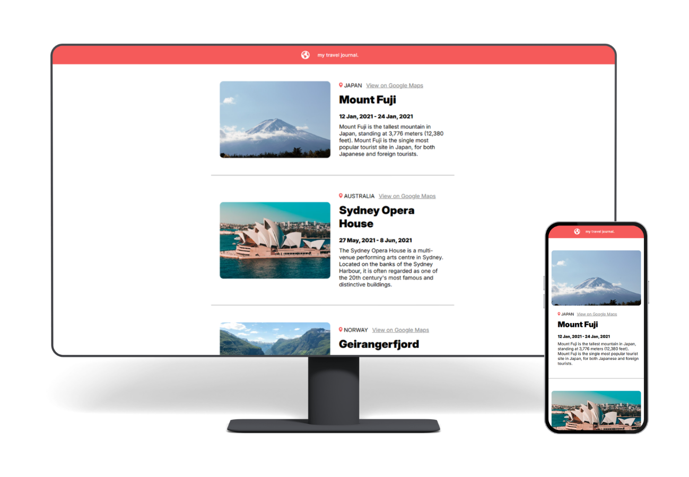

# Travel Journal

This Travel Journal is one of the projects from a React course offered by Scrimba through [Coursera](https://www.coursera.org/learn/learn-react/).

## Project Details

The goal of the project is to create a journal that offers information about key travel destinations. It is part of my Revisiting React series where I review various React concepts to practice my React skills.  

### View My Project: [https://ll-zerr.github.io/travel-journal/](https://ll-zerr.github.io/travel-journal/)

## Features

- Use of React components to populate the page with different travel destinations.
- When clicked, the destination image links to a travel page for information regarding the specific tourist spot.
- There is also the option to view the tourist spot on Google Maps via a link. 

## Technologies Used

- HTML5
- CSS3
- JavaScript
- React
- Vite

## My Process

- Start the files from a boiler template.
- Create components for the header and destination entries.
- Add styles for responsive web design.
- Add links to data for image functionality when clicked that lead to destination pages for further information.
- Modify package.json for deployment.
- Refactor code and add imports for assets to fix deployment issues.

### Continued development

With this project, I was able to test my React skills and enhance source code to include supplimental features within the application. I want to apply testing knowledge to this project, in the future, to exercise the skills I am learning for QA purposes.

## Acknowledgements

Original Project idea:  Bob Ziroll [Learn React course by Scrimba in Coursera](https://www.coursera.org/learn/learn-react/)

Destination Images sourced from:
- [Unsplash]()

    - Sydney Opera House: [Florencia Lewis](https://unsplash.com/@florlewis)
    - Geirangerfjord: [Sven](https://unsplash.com/@sphotos_00)

- [Scrimba](https://scrimba.com/home)
